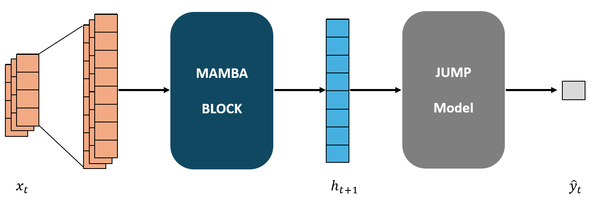

# Regime Mamba

Mamba(선택적 상태공간 모델)로 시계열 피처를 압축하고 Jump Model로 bull/bear 국면을 나누는 금융 국면 탐지 모델.



## 구조

```
run_pipeline.py          진입점 (CLI · run_pipeline() · run_inference())
regime_jm/
  data_io.py             1) 입력 로드·정제 → 초과수익률 (+ 벤치마크 상대수익률 rel_ret)
  features.py            2) 피처 세트 (paper / example / extra) + 사용자 변수 변환
  mamba_encoder.py          (--encoder mamba) 피처 시퀀스 → Mamba hidden 벡터
  rolling.py             3) 1·7월 재추정 + 사이 구간 온라인 추론 (Jump Model)
  sparse_pin.py             Sparse Jump Model (피처 고정 지원)
  backtest.py            4) 0/1 전략 백테스트 · 성과 · 거래 지연 로버스트니스
  hmm_benchmark.py       5) Gaussian HMM 벤치마크 (--hmm)
  weights.py             6) sjm 피처 가중 비중
  regime_episodes.py        bear 에피소드 · 유사 국면 · 종료 시나리오
  plotting.py            7) 그림
regime_mamba/
  models/mamba_model.py  Mamba 백본 (TimeSeriesMamba, --encoder mamba 가 사용)
  models/e2e_regime_mamba.py, train/e2e_train.py, config/e2e_config.py
                         End-to-End Regime Mamba (Mamba + 미분 가능한 jump penalty 로 국면을 직접 학습)
  data/, evaluate/       E2E 용 데이터셋 · 롤링 윈도우 · 스무딩 비교
scripts/e2e_backtest.py  E2E 롤링 백테스트 진입점
tests/                   인과성·파이프라인 테스트
```

## 실행

```bash
python run_pipeline.py data.csv                                        # 피처 → Jump Model
python run_pipeline.py data.csv --encoder mamba --device cuda:0        # 피처 → Mamba → Jump Model
python run_pipeline.py data.csv --encoder mamba --model sjm --feature-set extra --hmm
python run_pipeline.py sector.csv --relative-benchmark kospi.csv --backtest-ret relative
python run_pipeline.py data.csv --extra-features macro.csv:VIX:log macro.csv:USDKRW:logdiff
python run_pipeline.py data.csv --inference                            # 현재 반기만 추론
python run_pipeline.py data.csv --encoder mamba --n-seeds 5            # 시드 0~4: 개별 성과 평균 + 앙상블
python run_pipeline.py data.csv --encoder mamba --n-seeds 20 --seed-workers 8   # 시드 8개씩 동시에 실행
python run_pipeline.py data.csv --encoder mamba --mamba-horizons 1,5,20  # 다음 날·1주·1달 수익률을 동시에 예측하며 학습
python run_pipeline.py data.csv --encoder mamba --mamba-horizons 1,5,20 --mamba-loss-weights 0.5,0.25,0.25  # 손실 가중치
python run_pipeline.py data.csv --encoder mamba --mamba-horizons 5,20 --mamba-targets vol,mdd  # 1주·1달 변동성·MDD
python run_pipeline.py data.csv --encoder mamba --mamba-targets return,mdd --separate --separate-weights 0.3 0.5 0.7  # 따로 학습 → 비중별로 섞기
python run_pipeline.py data.csv --encoder mamba --feature-set example --mamba-targets return,mdd --separate \
    --separate-features mdd=DD-log,sortino_20 return=ret,sortino   # 타깃마다 다른 입력 피처
python run_pipeline.py data.csv --encoder mamba --mamba-targets return,mdd --separate \
    --separate-jump-penalty return=80 mdd=30                        # 타깃마다 다른 jump penalty
```

`--encoder`는 Jump Model 앞에 붙는 단계일 뿐이라, 아래 데이터·피처·모델·재추정·백테스트 옵션은 `--encoder none`과 `mamba`에서 똑같이 동작합니다.

## 옵션

| 단계 | 옵션 (기본값) |
|---|---|
| 데이터 | `--date-col/--close-col/--rf-col` (자동 인식), `--rf-unit annual_pct`, `--rf-const`, `--relative-benchmark`, `--signal-ret auto`, `--start/--end` |
| 피처 | `--feature-set paper\|example\|extra\|none`, `--extra-features 파일:열:변환`, `--remove-series`, `--use-features`, `--warmup 252` |
| 인코더 | `--encoder none\|mamba`, `--device auto\|cuda\|cuda:N`, `--mamba-seq-len 60`, `--mamba-warmup-context`, `--mamba-d-model 8`, `--mamba-d-state 32`, `--mamba-d-conv 4`, `--mamba-expand 2`, `--mamba-layers 4`, `--mamba-dropout 0.1`, `--mamba-epochs 100`, `--mamba-patience 10`, `--mamba-batch-size 1024`, `--mamba-lr 5e-4`, `--mamba-valid-frac 0.2`, `--mamba-horizons 1`, `--mamba-targets return`, `--mamba-loss-weights`, `--separate`, `--separate-weights`, `--separate-features`, `--separate-jump-penalty` |
| 모델 | `--model jm\|sjm`, `--discrete`, `--n-states 2`, `--jump-penalty 50`, `--max-feats`, `--pin-features`, `--n-init 10`, `--clip-mul 3`, `--center-distance` |
| 재추정 | `--train-window 3000`, `--min-train 500`, `--refit-months 1,7`, `--oos-start` |
| 백테스트 | `--delay 1`, `--delays 1,2,3,5,10`, `--min-cash 0`, `--max-cash 1`, `--cost-bps 10`, `--backtest-ret absolute\|relative` |
| 여러 시드 | `--n-seeds 1` (`--seed`부터 연속), `--seeds 0,1,2,3,4`, `--seed-mode ensemble\|individual\|both` (both), `--ensemble-bear-vote 0.4`, `--seed-workers 1`, `--seed-devices cuda:0,cuda:1` |
| HMM | `--hmm`, `--hmm-states 2`, `--hmm-refit 21`, `--hmm-median 5` |

- 피처 세트: `paper` = DD-log_10, sortino_20, sortino_60 / `example` = ret·DD-log·sortino × 5·20·60일 (9개) / `extra` = 9개 계열 × 5·20·60일 (27개).
- 사용자 변수 변환: `none, log, diff_n, pct_n, logdiff_n, zscore_w, ewm_hl, lag_n` (`+`로 연결).
- `--use-features sortino DD_20 VIX[log]`: 만든 피처(`--feature-set` · `--extra-features`, `--remove-series` 뒤) 중 이 피처만 모델 입력으로 씁니다(기본: 전부). 정확한 이름(`sortino_20`, `VIX[log]`) 또는 계열 이름(`sortino` = `sortino_5,sortino_20,sortino_60`)을 공백이나 콤마로 주고, 열 순서는 원래 순서를 따릅니다. 없는 이름이면 사용 가능한 피처 목록과 함께 오류가 납니다. 결측 행은 고른 피처로만 판단하므로, 늦게 시작하는 사용자 변수를 고르지 않으면 그 앞 날짜도 씁니다. `--encoder none`(jm/sjm)과 `mamba` 모두에서 동작하며, `sjm`의 `--pin-features`는 고른 피처 안에 있어야 합니다.
- 상태 0 = bull, 마지막 상태 = bear. 0/1 전략은 bear일 때 현금(`relative`면 벤치마크)을 보유합니다.
- `--encoder mamba`: 재추정마다 학습창으로 Mamba를 새로 학습하고(시퀀스 → 다음 날 수익률, MSE, 뒤쪽 `--mamba-valid-frac`로 early stopping), 각 날짜의 마지막 hidden 벡터 `h_0..`를 Jump Model 입력으로 씁니다. mamba-ssm은 CUDA 전용이라 GPU가 없으면 시작 단계에서 에러로 끝납니다. `--pin-features`는 쓸 수 없습니다.
- `--mamba-horizons 1,5,20`: Mamba 출력을 horizon 수만큼 늘려 다음 날·5거래일·20거래일 뒤까지의 수익률(t+1..t+h 일별 신호 수익률의 합, 학습창의 h일 수익률 표준편차로 나눔)을 동시에 예측하도록 학습합니다(기본: horizon별 MSE의 평균, `--mamba-loss-weights`로 가중합). 타깃이 모두 재추정일 이전인 시퀀스만 쓰고, 학습 타깃이 검증 구간과 겹치지 않게 학습·검증 사이 `max(h)-1`개 시퀀스를 버립니다. Jump Model 입력은 여전히 hidden 벡터이며, `mamba_train_log.csv`에 horizon별 검증 손실 `valid_loss_h<h>`가 추가됩니다. 기본값 `1`은 기존(다음 날만 예측)과 같습니다.
- `--mamba-targets return,vol,mdd`: 수익률 대신(또는 함께) 예측할 값입니다. 각 타깃 × `--mamba-horizons`가 출력이 됩니다.
- `--mamba-loss-weights 0.5,0.25,0.25`: 출력별 MSE를 단순 평균하는 대신 가중합합니다. horizon 수만큼 주면 horizon별 가중치(타깃이 여러 개면 모든 타깃에 같은 가중치)이고, 타깃 × horizon 수만큼 주면 출력별 가중치(타깃 → horizon 순서, 예: `--mamba-targets return,vol --mamba-horizons 5,20`이면 return_h5, return_h20, vol_h5, vol_h20)입니다. 합으로 나눠 정규화하므로 `2,1,1`도 `0.5,0.25,0.25`와 같습니다. 0 이상이어야 하며, early stopping의 검증 손실(`mamba_train_log.csv`의 `valid_loss`)도 같은 가중합입니다. 출력별 검증 손실 `valid_loss_<출력>`은 가중치 없이 그대로 기록됩니다.
  - `return`: t+1..t+h 일 신호 수익률 합, 학습창의 h일 값 표준편차로 나눔 (기본).
  - `vol`: t+1..t+h 일 실현 변동성 `sqrt(mean(r²))` (일간 단위), 학습창의 h일 값으로 표준화.
  - `mdd`: t일 종가에서 시작한 `(1+r)` 복리 경로의 최대 낙폭 `1 - min(W/이전 고점)` (0 이상), 학습창의 h일 값으로 표준화.
  - 여러 타깃이면 `mamba_train_log.csv`의 검증 손실 열이 `valid_loss_<타깃>_h<h>`입니다.
- `--separate`: `--mamba-targets`의 타깃을 한 Mamba로 함께 학습하지 않고, 타깃마다 그 타깃만 예측하는 Mamba → Jump Model을 따로 돌린 뒤(`target_<타깃>/`, 각자 일반 실행과 같은 결과 파일) 날짜마다 상태 확률을 비중대로 섞어 국면을 정합니다: `prob = Σ 비중 × (그 타깃의 시드 평균 상태 확률)`, argmax가 국면입니다. 상태 순서는 모든 모델이 같은 규칙(0 = bull, 마지막 = bear)이라 바로 섞을 수 있습니다.
  - `--separate-weights 0.7,0.3 0.5,0.5`: 섞을 비중 목록입니다. 비중마다 타깃 수만큼 콤마로 주고(`--mamba-targets` 순서, 합으로 정규화), 타깃이 2개면 첫 타깃 비중 하나만 줘도 됩니다(`0.3` = `0.3,0.7`). 여러 개 주면 학습은 한 번만 하고 비중마다 결과를 `blend_<이름>/`(예: `blend_return0.7_mdd0.3/`)에 저장합니다. 기본은 균등 비중 하나입니다.
  - `separate_performance.csv`에 타깃 단독(`return`, `mdd`)과 비중별 결과가 `w_<타깃>` 열과 함께 한 표로 정리되고, `separate_current_state.csv`에 각각의 현재 국면이, `separate_cumret.png`에 누적수익률이 함께 그려집니다. 비중 `1`(또는 `0`)은 타깃 단독 행과 같아 따로 폴더를 만들지 않습니다.
  - 여러 시드(`--n-seeds`)와 함께 쓰면 타깃마다 시드 실행을 그대로 하고(`target_<타깃>/seed_<s>/`, `ensemble/`), 섞을 때는 타깃 비중을 그 타깃의 시드 수로 나눠 시드별 확률에 줍니다. `--ensemble-bear-vote X`를 주면 비중으로 가중한 bear 표 비율(`bear_vote`)이 X 이상인 날을 bear로 삼습니다(시드가 하나여도 사용 가능). `--inference`와 함께 쓰면 현재 반기 국면만 섞습니다.
  - `--separate-features mdd=a,b,c return=b,c,d`: 타깃마다 Mamba에 넣을 입력 피처를 따로 정합니다. `타깃=피처,피처` 형식(`타깃:피처,..`도 가능)으로 타깃마다 하나씩 주고, 피처는 `--feature-set` · `--extra-features`로 만든(`--remove-series` 뒤) 피처 중에서 정확한 이름(`sortino_20`, `VIX[log]`) 또는 계열 이름(`sortino` = `sortino_5,sortino_20,sortino_60`)으로 고릅니다. 이름이 없으면 사용 가능한 피처 목록과 함께 오류가 납니다. 주지 않은 타깃은 `--use-features`(없으면 피처 전부)를 씁니다. `--separate-features`는 `--use-features`와 상관없이 전체 피처에서 고릅니다. 각 타깃의 `target_<타깃>/features.csv`에 실제 입력이, `run_config.json`의 `use_features`에 고른 이름이 남습니다.
    - 결측 행은 그 타깃이 고른 피처로만 판단하므로(예: 늦게 시작하는 사용자 변수를 안 쓰는 타깃은 그 앞 날짜도 사용) 타깃마다 시작일·재추정일이 다를 수 있고, 섞을 때는 모든 타깃에 있는 날짜만 씁니다.
  - `--separate-jump-penalty return=80 mdd=30`: 타깃마다 Jump Model의 jump penalty를 따로 정합니다. `타깃=값` 형식(`타깃:값`도 가능)으로 타깃마다 하나씩 주고(0 이상), 주지 않은 타깃은 `--jump-penalty`를 씁니다. 각 타깃의 `target_<타깃>/run_config.json`의 `jump_penalty`에 실제 값이 남습니다.
  - `--mamba-loss-weights`는 horizon 수만큼 주면 각 타깃 모델에 그대로, 타깃 × horizon 수만큼 주면 각 타깃 모델에 자기 몫만 씁니다. 타깃은 순서대로 하나씩 학습하며, 시드 병렬(`--seed-workers`)은 타깃마다 적용됩니다.
- `--center-distance`: `regimes.csv`(`--inference`면 `inference_regimes.csv`)에 날짜별 상태 중심점과의 유클리드 거리 `dist_0..`를 추가합니다. 거리는 모델이 손실을 재는 공간(학습창 기준 클리핑·표준화, `sjm`이면 피처 가중치를 곱한 공간, `--encoder mamba`면 hidden 벡터)에서 그 반기를 맡은 재추정 모델의 중심점으로 계산합니다. Jump Model의 손실은 `0.5 × dist²`이며, jump penalty 때문에 국면이 항상 가장 가까운 중심점과 일치하지는 않습니다. 개별 모델의 값이라 여러 시드 실행에서는 `seed_<s>/`에만 들어가고 앙상블 표에는 없습니다.
- 여러 시드 (`--n-seeds`/`--seeds`가 2개 이상): 시드는 Jump Model 초기값(`--n-init`)과 Mamba 가중치 초기화·배치 순서를 바꿉니다.
  - `individual`: 시드마다 전체 파이프라인을 `seed_<s>/`에 저장하고, 전략 성과의 평균·표준편차·최소·최대를 `seed_performance.csv`로 정리합니다.
  - `ensemble`: 날짜마다 시드별 상태 확률을 평균해 argmax를 국면으로 삼고(이산형이면 다수결) 한 번 백테스트해 `ensemble/`에 저장합니다. HMM·에피소드 분석은 하지 않습니다.
  - `both`: 둘 다 하며, 앙상블은 개별 실행 결과를 재사용합니다. `seed_performance.csv`에 `ensemble` 행이 함께 들어갑니다.
  - `--ensemble-bear-vote X` (0~1): bear 국면에 더 빨리 반응하도록, bear로 판정한 시드 비율(`bear_vote`)이 X 이상인 날을 앙상블 bear로 삼습니다 (예: `0.4`면 5개 시드 중 2개). 나머지 날은 bear를 뺀 상태 중 평균 확률이 가장 큰 상태입니다. 상태 확률 평균(`prob_k`)은 그대로이고, 국면·전략·`current_state.json`(`bear_vote`, `bear_vote_threshold`)에 반영됩니다.
  - `--inference`와 함께 쓰면 시드별 · 앙상블 현재 국면만 저장합니다.
  - `--seed-workers N`: 시드 N개를 별도 프로세스에서 동시에 실행합니다 (기본 1 = 순차). 시드마다 프로세스가 따로라 난수 상태가 섞이지 않고, 결과 파일은 순차 실행과 같습니다. Mamba 모델이 작아 시드 하나로는 GPU를 다 쓰지 못하므로 동시에 돌리면 전체 시간이 줄어듭니다. 프로세스마다 CUDA 컨텍스트(수백 MB)와 학습 메모리가 따로 들므로 `nvidia-smi`로 메모리를 보며 4~8부터 늘려 보세요. 작업 프로세스의 BLAS/OpenMP 스레드는 `CPU 코어 수 / N`개로 제한합니다(`OMP_NUM_THREADS` 등을 직접 지정했으면 그 값 사용). 로그 줄 앞에는 `[seed s]`가 붙습니다.
  - `--seed-devices cuda:0,cuda:1` (`--encoder mamba`): 시드를 목록의 GPU에 돌아가며 배정합니다 (시드 0→cuda:0, 1→cuda:1, 2→cuda:0, …). 지정하지 않으면 모든 시드가 `--device`를 씁니다.

## 출력 (`--out`, 기본 `out/`)

| 파일 | 내용 |
|---|---|
| `regimes.csv` | 날짜별 국면·상태 확률·재추정일 (`--center-distance`면 중심점 거리 `dist_k`) |
| `refit_params.csv` | 재추정 × 상태별 중심점, 연율 수익률·변동성, stay_prob |
| `strategy.csv`, `performance.csv`, `delay_robustness.csv` | 전략 일별 내역, 성과, 지연별 성과 |
| `feat_weights.csv`, `weight_groups*.csv` | (sjm) 피처 가중치와 그룹별 비중 |
| `regime_episodes.csv`, `similar_episodes.csv`, `length_scenarios.csv` | 에피소드, 유사 국면, 종료 시나리오 |
| `hmm_regimes.csv`, `model_comparison.csv` | (--hmm) HMM 비교 |
| `mamba_train_log.csv` | (--encoder mamba) 재추정별 epoch, train/valid loss (출력이 여러 개면 `valid_loss_h<h>` 또는 `valid_loss_<타깃>_h<h>`) |
| `current_state.json`, `run_config.json`, `*.png` | 현재 국면, 실행 설정, 그림 |
| `seed_<s>/`, `seed_performance.csv`, `seed_current_state.csv` | (여러 시드 · individual) 시드별 결과, 시드별 성과와 평균·표준편차, 시드별 현재 국면 |
| `target_<타깃>/`, `blend_<이름>/`, `separate_performance.csv`, `separate_current_state.csv`, `separate_cumret.png` | (--separate) 타깃별 실행 결과, 비중별 섞은 결과(`regimes.csv`에 섞은 확률 `prob_k`, 타깃별 확률 `prob_k_<타깃>`, 모델별 국면 `regime_<타깃>[_seed<s>]`, `agreement`, `bear_vote`), 타깃 단독 · 비중별 성과 비교표와 현재 국면 |
| `ensemble/` | (여러 시드 · ensemble) `regimes.csv`(평균 확률, `agreement`, `bear_vote`, `regime_seed<s>`), `strategy.csv`, `performance.csv`, `delay_robustness.csv`, `current_state.json` |

`--inference`는 최근 반기 시작점 직전 학습창으로 한 번만 학습하고 현재 반기만 추론합니다 (`inference_*.csv`).

## End-to-End Regime Mamba (`scripts/e2e_backtest.py`)

Jump Model 없이 Mamba가 국면 확률을 직접 출력하도록 학습하는 실험용 모델입니다 (Gumbel-Softmax, jump penalty · 분리 · 2단계 엔트로피 손실). `[학습 train_years][검증 valid_years]` 창을 `forward_months`씩 옮기며 학습하고, 다음 구간에서 스무딩 방법별 전략 성과를 비교합니다.

```bash
python scripts/e2e_backtest.py --data_path data.csv --feature_set paper --e2e_preset balanced   # CSV: Date, returns, target_returns_1
```

## 인과성 규칙 (`tests/`에서 검증)

- 클리핑·표준화·Mamba 학습은 재추정일 이전 학습창으로만 합니다.
- t일의 국면(과 hidden 벡터)은 t일까지의 데이터만 씁니다.
- 거래는 신호보다 `--delay`일 늦게 체결됩니다.

## License

CC BY-SA 4.0. 데이터: S&P 500·T-bill·Dollar Index·개별 종목(Yahoo Finance), KOSPI·CD-91(한국은행 ECOS, KOGL Type 1).
